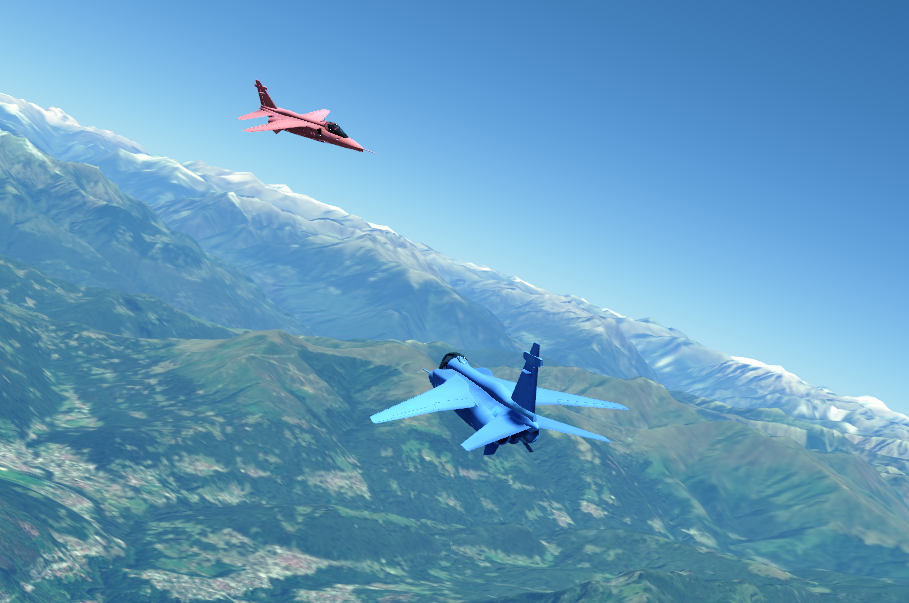

# FlightSim 

This is a modified version of the project called [Skybolt](https://github.com/Prograda/Skybolt/tree/master). It is used as MARL environment for realistic simulations and human-agent interactions.

*TODO:* 

- Init location directly as instance creation of FlightSim(loc) for JSBSim, otherwise performance decrease!
- Read out state of JSBSim aircraft for Human-Agent Interaction --> partially done, see `test_flightsim.py` in [HHMARL3D](https://github.com/ardian-selmonaj/HHMARL_3D)
- Better to set init position, then orientation and velocity to let C++ enginge simulate future states instead of setting the attitude by Python-JSBSim.

## INSTALLING ON WINDOWS

1) In the local clone of this repository, run `setup_windows.bat` (double-click it or run it in a terminal). It does the complete setup. Each step is skipped if it is already done, so it can be re-run at any time, e.g., to rebuild after changing the C++ code:
- installs the VS 2022 Build Tools with the C++ build tools workload (MSVC v143, Windows SDK, C++ CMake tools for Windows) using `Tools\VSBuildTools.exe` of this repository (downloaded if missing). This step asks for administrator rights.
- loads the MSVC compiler environment, so the "Developer Command Prompt for VS 2022" is not needed
- creates the Python 3.11 virtual environment `.venv` with an installed Python 3.11. If there is none, Python 3.11.9 (the latest 3.11 with a Windows installer) is installed for the current user next to any other Python versions, without changing PATH, file associations or the default `python`. The venv gets `conan==2.22.0`, `jsbsim==1.3.3` and `requests`
- creates a default conan profile (if there is none) and builds the project with `compiler.cppstd=17` (needed for JSBSim) into `FlightSimBuild` next to the repository. The first build compiles all dependencies and takes long.
- sets the root directory of JSBSim in the Skybolt settings, located under "user\AppData\Local\Skybolt\Settings.json". The JSBSim aircraft data comes with the `jsbsim` Python package, so no separate JSBSim installation is needed. An existing valid `rootDir` is kept.
- checks that `import skybolt` works

- Options: `setup_windows.bat -BuildDir D:\FlightSimBuild` builds into another folder (then set the environment variable `FLIGHTSIM_BUILD_DIR` to that folder), `setup_windows.bat -PythonExe C:\path\to\python.exe` uses a Python 3.11 in a non-standard location.

2) for realistic rendering, run `.venv\Scripts\python Tools\Tile_Map_Downloader.py`. For Switzerland, the map tiles (zoom levels 0-14) are already available under the links [Terrain](https://drive.google.com/file/d/1lMife7PamdICDU4D7hoqI3tCQr1aqn9c/view?usp=sharing) and [Satellite](https://drive.google.com/file/d/1CQ3N1oqyjL1ly_6SO7m9wICEsS0f2zVm/view?usp=sharing), as zips of tiles that were already downloaded from Mapbox. The script downloads both zips and unzips them into `Assets\mapbox_terrain_ch` and `Assets\mapbox_satellite_ch`, where the entity `Assets\Globe\Entities\PlanetEarth.json` looks for the map tiles. Tiles that already exist in `Assets` are not downloaded again. If the download fails (e.g., the link expired), download the zips manually and unzip them into `Assets`.

- For increased depth (better details), further zoom levels need to be downloaded directly from Mapbox with the same script, e.g., `.venv\Scripts\python Tools\Tile_Map_Downloader.py --zoom 15 16`. Existing tiles are skipped. Afterwards, raise `maxLevel` in `PlanetEarth.json` accordingly. The area is set by `CENTER_LATITUDE`, `CENTER_LONGITUDE` and the ranges in the script. Note that the number of tiles grows about 4x per zoom level. Of course, you can use any other map tiles from Mapbox or any other source.

3) run `.venv\Scripts\python Test_FlightSim_Windows.py`. Python scripts using Skybolt only need `import flightsim_env` before `import skybolt` (see `flightsim_env.py`). For more Python Bindings, need to extend `FlightSim\src\Skybolt\SkyboltPythonBindings\PythonBindings.cpp` appropriately and re-run `setup_windows.bat`. 

*NOTE 1*: The repo and build folder need short paths, otherwise Windows build tools break if path exceeds 260 characters.

*NOTE 2*: when pushing with git, set `git config --global core.autocrlf false` to use LF accross all platforms.

## INSTALLING ON LINUX

Tested with Ubuntu 24.04 under WSL2. The setup installs the system packages with `apt`, i.e., it is meant for Debian and Ubuntu.

1) In the local clone of this repository, run `./setup_linux.sh`. It does the complete setup. Each step is skipped if it is already done, so it can be re-run at any time, e.g., to rebuild after changing the C++ code:
- installs the missing system packages with `apt`: compiler, CMake, OpenGL and X11 development files. This step asks for the `sudo` password if packages are missing.
- creates the Python 3.11 virtual environment `.venv` with [uv](https://docs.astral.sh/uv/), which is installed into `~/.local/bin` if it is missing. If there is no Python 3.11 managed by uv, uv installs one for the current user next to any other Python versions, without changing the system Python or the default `python`. The venv gets `conan==2.22.0`, `jsbsim==1.3.3`, `requests` and `pip`
- checks the compiler (GCC 11 or newer) and CMake. If the CMake of the system is older than 3.26 (e.g., on Ubuntu 22.04), a newer CMake is installed into `.venv`
- creates a default conan profile (if there is none) and builds the project into `FlightSimBuild` next to the repository. The first build compiles all dependencies and takes long.
- sets the root directory of JSBSim in the Skybolt settings, located under `~/Skybolt/Settings.json`. The JSBSim aircraft data comes with the `jsbsim` Python package, so no separate JSBSim installation is needed. An existing valid `rootDir` is kept.
- checks that `import skybolt` works

- Options: `./setup_linux.sh --build-dir ~/FlightSimBuild` builds into another folder (then set the environment variable `FLIGHTSIM_BUILD_DIR` to that folder), `./setup_linux.sh --python /usr/bin/python3.11` creates `.venv` with a specific Python 3.11 (it needs the development files, e.g., `python3.11-dev`), `./setup_linux.sh --jobs 4` sets the number of parallel compile jobs (by default, it depends on the CPU cores and the memory).

2) for realistic rendering, run `.venv/bin/python Tools/Tile_Map_Downloader.py`, as described in step 2 of the Windows installation. Under WSL2, the map tiles can also be copied from a Windows clone, e.g., `cp -r /mnt/c/<path to clone>/Assets/mapbox_* Assets/` (reading them directly from `/mnt/c` is slow).

3) run `.venv/bin/python Test_FlightSim_Linux.py`. As on Windows, Python scripts using Skybolt only need `import flightsim_env` before `import skybolt` (see `flightsim_env.py`). On Linux, it loads the shared libraries of the build, so `LD_LIBRARY_PATH` does not need to be set. For more Python Bindings, need to extend `FlightSim/src/Skybolt/SkyboltPythonBindings/PythonBindings.cpp` appropriately and re-run `./setup_linux.sh`.

*NOTE 1*: A desktop session is needed to open the window. Under WSL2, it is provided by WSLg. There, Mesa renders on the CPU unless its driver for the GPU is selected, which `flightsim_env.py` does (`GALLIUM_DRIVER=d3d12`). Otherwise, the simulation is about 25x slower.

*NOTE 2*: In contrast to Windows, the build does not set `compiler.cppstd=17`. The conan profile detected for GCC has `gnu17`, which JSBSim accepts, and changing it would rebuild all dependencies.

## RENDERING SCENE

